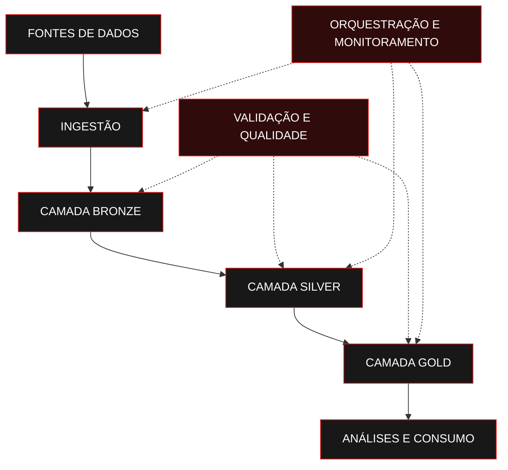

 

# FLÁVIO ALVES

### Engenharia de Dados | Automação | Tecnologia

**Transformando dados em informação. Informação em inteligência.**

---

## 01. SOBRE MIM

Sou estudante de **Sistemas de Informação**, com direcionamento profissional para Engenharia de Dados, automação e construção de soluções tecnológicas.

Minha trajetória combina experiência em operações logísticas e administração de sistemas com desenvolvimento de projetos envolvendo processamento, integração, armazenamento e análise de dados.

Tenho interesse em construir soluções que resolvam problemas reais de negócio: desde a coleta de dados em diferentes fontes até a disponibilização de informações confiáveis para apoiar decisões.

**Meu objetivo:** desenvolver arquiteturas de dados eficientes, automatizadas, escaláveis e sustentáveis.

---

## 02. EXPERIÊNCIA E CONHECIMENTOS

| Área | Experiência e atuação |
|---|---|
| Logística | Controle de estoque, inventário, transporte e indicadores operacionais |
| Administração de sistemas | Automação de tarefas, gerenciamento de usuários e monitoramento de máquinas |
| Engenharia de dados | Construção de pipelines, integração de fontes e transformação de dados |
| Banco de dados | Consultas SQL, modelagem e persistência de informações |
| Automação | Scripts, processos automatizados e integração entre sistemas |

---

## 03. TECNOLOGIAS E FERRAMENTAS

### Linguagens e processamento

### Banco de dados e armazenamento

### Engenharia e orquestração

### Desenvolvimento e ambiente

---

## 04. PROJETOS EM DESTAQUE

Projetos desenvolvidos para aplicar conceitos de engenharia de dados, análise, integração e automação em cenários práticos.

### 01 — Urban Mobility Analytics

**Engenharia de dados aplicada à mobilidade urbana.**

Projeto de processamento de dados de corridas de táxi de Nova York, utilizando uma arquitetura de dados em camadas e ferramentas de engenharia de dados.

- Processamento de dados de janeiro a junho de 2025.
- Aproximadamente 23,8 milhões de registros carregados no PostgreSQL.
- Transformações e validações com dbt.
- 14 operações executadas e 8 testes de qualidade aprovados.
- DAG do Airflow reconhecida e validada, sem conclusão de execução integral ponta a ponta.

**Tecnologias:** Python, PySpark, Docker, PostgreSQL, dbt e Airflow.

[ACESSAR PROJETO →](https://github.com/flavioalves1919-cell/urban-mobility-analytics)

---

### 02 — PE Inteligência

**Integração de dados públicos de Pernambuco.**

Projeto voltado à construção de uma plataforma de integração e inteligência de dados, com foco em informações fiscais e de saúde pública.

- Integração de fontes públicas.
- Ingestão e tratamento de dados com Python.
- Organização de dados para análises posteriores.
- Desenvolvimento de uma estrutura local e econômica.

**Tecnologias:** Python, SQL, APIs e Engenharia de Dados.

[ACESSAR PROJETO →](https://github.com/flavioalves1919-cell/PE-Inteligncia-0-0)

---

### 03 — Inteligência de Clientes

**Análise de retenção, comportamento e cancelamento de clientes.**

Projeto de inteligência de clientes com aplicação de técnicas de análise de dados para apoiar decisões de negócio.

- Análise RFM.
- Identificação de padrões de churn.
- Análise de retenção.
- Consultas e organização de dados.
- Geração automatizada de relatórios executivos em PDF.

**Tecnologias:** Python, PostgreSQL e SQL.

[ACESSAR PROJETO →](https://github.com/flavioalves1919-cell/Inteligencia-Clientes)

---

### 04 — Centro de Controle Logístico

**Dados e indicadores aplicados à gestão logística.**

Projeto voltado à organização e análise de informações de operações logísticas.

- Indicadores de estoque e inventário.
- Análise de transporte.
- Indicadores de produtividade.
- Controle de operações de armazém.
- Consultas e processamento de dados operacionais.

**Tecnologias:** Python, SQL e PostgreSQL.

[ACESSAR PROJETO →](https://github.com/flavioalves1919-cell/Centro-Controle-Logistico)

---

## 05. COMO PENSO UMA SOLUÇÃO DE DADOS

Uma solução de Engenharia de Dados precisa ir além de fazer um script funcionar. Ela deve entregar dados confiáveis, processos reproduzíveis e valor para o negócio.

**Princípios que considero importantes:**

- Qualidade e consistência dos dados.
- Processamento incremental sempre que adequado.
- Idempotência e prevenção de duplicidades.
- Tratamento de erros, logs e retentativas.
- Segurança e controle de acesso.
- Monitoramento de custos e desempenho.
- Documentação e facilidade de manutenção.

---

## 06. INDICADORES DO GITHUB

---

## 07. FOCO DE DESENVOLVIMENTO

Atualmente, meu direcionamento de estudos e projetos está concentrado em:

- Arquitetura e modelagem de dados.
- Engenharia de pipelines ETL e ELT.
- Python e SQL aplicados a dados.
- Processamento distribuído com PySpark.
- Qualidade, transformação e governança de dados.
- Orquestração de processos.
- Infraestrutura e ambientes com Docker.
- Integração de APIs e automação.

---

# RED CORE

### DADOS • TECNOLOGIA • INTELIGÊNCIA

**Construindo soluções. Evoluindo continuamente.**

[VISITAR MEUS REPOSITÓRIOS](https://github.com/flavioalves1919-cell?tab=repositories)

Portfólio de Flávio Alves | Engenharia de Dados

