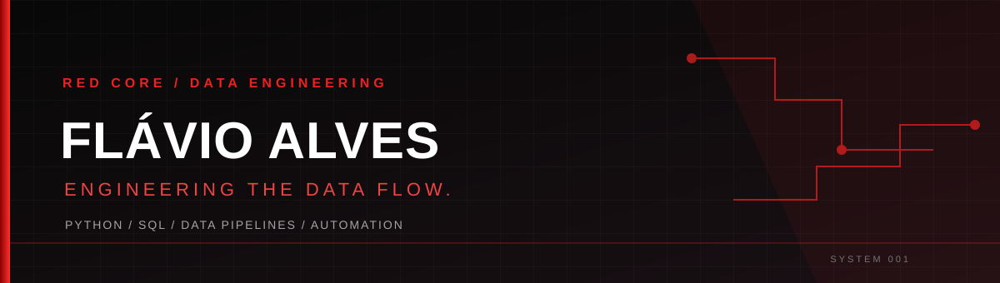

 

### DATA ENGINEERING · AUTOMATION · TECHNOLOGY

Building data pipelines, transforming information into intelligence.

---

## `01` / ABOUT ME

I'm Flávio Alves, a Systems Information student focused on **Data Engineering**.

I have practical experience in logistics operations and systems administration, and I'm developing projects involving data processing, database engineering, ETL pipelines and automation.

My goal is to build reliable data solutions that turn raw information into useful business intelligence.

---

## `02` / TECHNOLOGY STACK

---

## `03` / FEATURED PROJECTS

### 01. Urban Mobility Analytics

Data engineering project focused on processing urban mobility data using a modern data stack.

**Technologies:** Python · PySpark · Docker · PostgreSQL · dbt · Airflow

[→ Explore repository](https://github.com/flavioalves1919-cell/urban-mobility-analytics)

### 02. PE Inteligência

Project focused on data integration and analysis for the state of Pernambuco.

**Technologies:** Python · Data Engineering · APIs

[→ Explore repository](https://github.com/flavioalves1919-cell/PE-Inteligncia-0-0)

### 03. Inteligência de Clientes

Customer intelligence project involving RFM analysis, churn, retention and automated executive reports.

**Technologies:** Python · PostgreSQL · SQL

[→ Explore repository](https://github.com/flavioalves1919-cell/Inteligencia-Clientes)

### 04. Centro de Controle Logístico

Logistics analytics project focused on inventory, transportation, warehouse operations and KPIs.

**Technologies:** Python · SQL · PostgreSQL

[→ Explore repository](https://github.com/flavioalves1919-cell/Centro-Controle-Logistico)

---

## `04` / GITHUB ANALYTICS

---

### BUILDING. LEARNING. ENGINEERING.

RED CORE · DATA ENGINEERING PORTFOLIO

